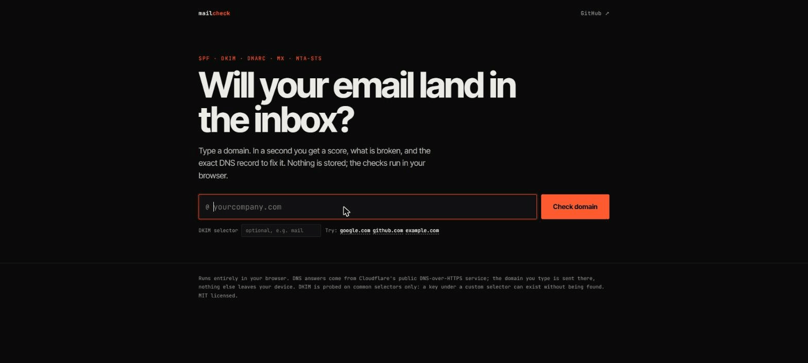
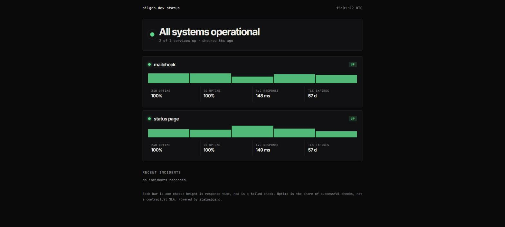
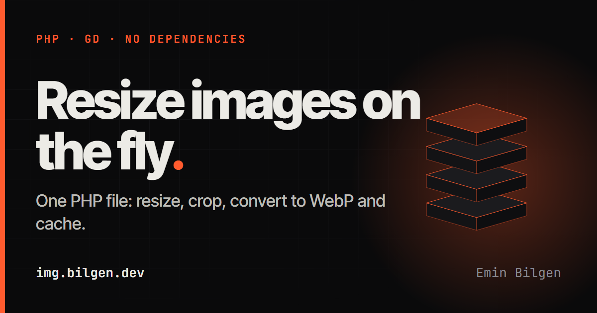
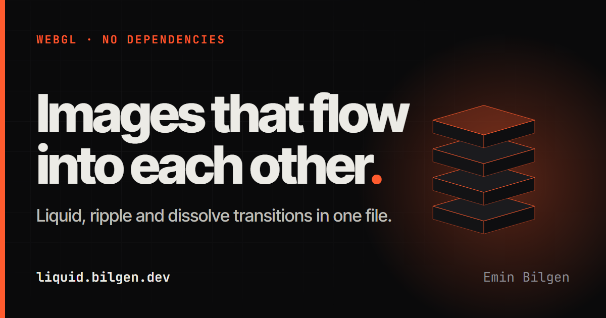

  

  
  
  
  

<h3 align="center">I design, build and host the whole thing. Interactive front ends, APIs, payment systems and the servers underneath.</h3>

Ankara, Türkiye · independent

---

## 🛠 What I build

<table>
  <tr>
    <td width="50%" valign="top">🎨 <b>Web experiences</b> React, vanilla JavaScript, WebGL. Motion-led interfaces that feel like products, not templates.</td>
    <td width="50%" valign="top">⚙️ <b>Back ends</b> PHP and Python APIs, admin panels, image pipelines and CDNs.</td>
  </tr>
  <tr>
    <td valign="top">💳 <b>Payment infrastructure</b> Multi-chain checkout, merchant ledgers and sweeps.</td>
    <td valign="top">📡 <b>Infrastructure</b> Self-run hosting, mail (SPF, DKIM, DMARC), DNS and TLS.</td>
  </tr>
</table>

## 🧰 Stack

  

## 🚀 Open source

<table>
  <tr>
    <td width="50%" valign="top">
      <h3><a href="https://github.com/eminbilgen/mailcheck">mailcheck</a></h3>
      
Will your email land in the inbox? SPF, DKIM, DMARC, MX and MTA-STS checked in a second, with the exact DNS record to fix what is broken. CLI and in-browser demo, zero dependencies.

      
<a href="https://mailcheck.bilgen.dev"><b>Try it live →</b></a>

      
    </td>
    <td width="50%" valign="top">
      <h3><a href="https://github.com/eminbilgen/statusboard">statusboard</a></h3>
      
A self-hosted status page. A tiny Node monitor writes JSON, a static page shows uptime, latency, TLS expiry and incidents. No database, no dependencies.

      
<a href="https://status.bilgen.dev"><b>See it live →</b></a>

      
    </td>
  </tr>
  <tr>
    <td width="50%" valign="top">
      <h3><a href="https://github.com/eminbilgen/imgserve">imgserve</a></h3>
      
Resize, crop and convert images on the fly with one PHP file. WebP output, disk cache, ETag and path-traversal protection. No Composer, no framework.

      
<a href="https://img.bilgen.dev"><b>Try it live →</b></a>

      
    </td>
    <td width="50%" valign="top">
      <h3><a href="https://github.com/eminbilgen/liquid-transitions">liquid-transitions</a></h3>
      
WebGL image transitions in one file: liquid, ripple and dissolve. No dependencies.

      
<a href="https://liquid.bilgen.dev"><b>See it live →</b></a>

      
    </td>
  </tr>
</table>

More tools on the way.

## 🤝 Work together

Have something to ship? Tell me what you are building and I will reply with a plan, a price and a date.

  

